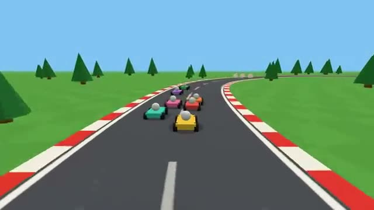

# Kart Circuit

Three laps, item boxes and drift boosts. A multiplayer starter game from [Multiplayer Agent](https://multiplayeragent.com): 3D, versus, 2–8 players, with bots that fill empty seats.

## How it plays

Drift through corners to charge a boost. Item boxes give a speed boost or a shell for whoever is just ahead. First over the line after three laps wins.

**Controls:** Arrow keys, Shift to drift, Space for items, or on-screen buttons.

## Make it yours in the Game Builder

Open the [Game Builder](https://multiplayeragent.com), choose **Start from a starter game** and pick Kart Circuit. It opens as version 1 in your studio, ready to play and publish. Then ask for changes, for example:

- Add a second track in the snow
- Add a banana you drop behind you
- Let players pick a kart color before the race

## Run it yourself

1. Get a free publishable key (`pk_…`) at [multiplayeragent.com](https://multiplayeragent.com).
2. In `index.html`, put it in place of `pk_REPLACE_ME` in the `MP_CONNECT` block.
3. Serve the folder (for example `npx serve`) and open it. The 3D engine loads as a module, which browsers block from a file on disk.

Without a key it still runs, offline against bots.

## How it is built

- One `index.html` plus three.js in `libs/`. The comment at the top of the script maps the code and explains the multiplayer.
- **Leaderboard:** The fastest laps on the track.
- **Rounds:** Races start, finish and restart together for everyone.
- **Bots:** Bots fill the grid until enough people join.
- `?attract` runs it offline with bots only. The preview video is recorded from it.

## License

MIT. three.js in `libs/` is MIT too (Copyright 2010-2024 three.js authors).
